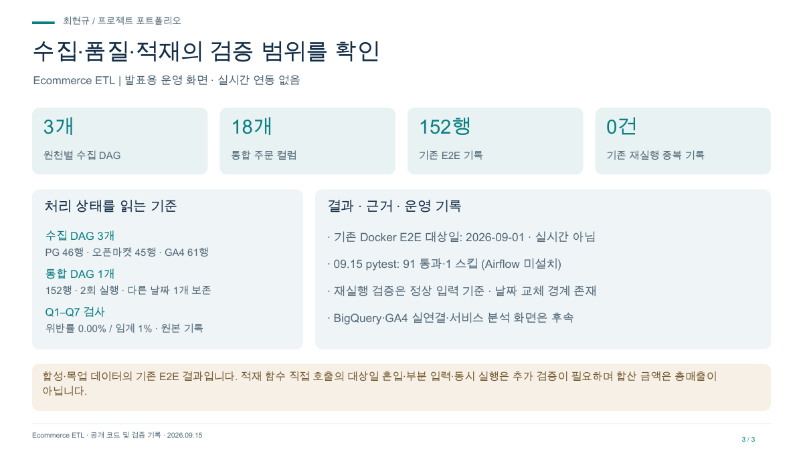

# Ecommerce ETL 발표 자료

서로 다른 주문 데이터를 같은 계약으로. 소개·처리 흐름·운영 관점으로 구성한 3장 자료입니다.

- [발표 PDF](project.pdf)
- [편집 가능한 PPT](project.pptx)
- [대시보드 미리보기](dashboard.png)

## 담당 범위

담당: 원천별 수집 · 스키마 매핑 · 품질 검사 · 로컬 적재

## 검증 범위 · 2026-09-15

합성·목업 데이터의 기존 E2E 결과입니다. 적재 함수 직접 호출의 대상일 혼입·부분 입력·동시 실행은 추가 검증이 필요하며 합산 금액은 총매출이 아닙니다.

실시간 관제 서비스가 아닌 발표용 화면입니다. 수치는 검증 시점 또는 예시 범위를 따릅니다.
